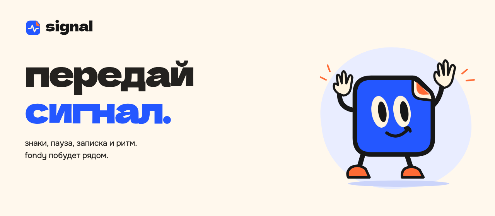

<p align="center">
  
</p>

<p align="center">небольшой браузерный проект Тимофея Чебатуркина</p>

<p align="center">
  <a href="#чем-можно-заняться">что внутри</a> ·
  <a href="#запустить-локально">запустить</a> ·
  <a href="#как-устроен-проект">исходники</a>
</p>

собери свой сигнал из нескольких знаков, напиши записку или просто сделай паузу. fondy сопровождает тебя по всей странице и реагирует на действия. на большом экране он остаётся сбоку, на телефоне занимает компактную полосу над сценами.

всё работает в браузере. без аккаунта, сервера и аналитики.

## чем можно заняться

<table>
<tr>
<td width="50%" valign="top">

### знаки


выбери до четырёх знаков и расставь их по-своему. можно нажимать, перетаскивать и убирать лишнее.

</td>
<td width="50%" valign="top">

### пауза


заметь, удержи, отпусти, останься. любой шаг можно пропустить или начать заново.

</td>
</tr>
<tr>
<td width="50%" valign="top">

### записка


напиши до 120 знаков, выбери символ и сверни записку в конверт. потом её можно скачать как открытку.

</td>
<td width="50%" valign="top">

### ритм


нажимай кнопки или клавиши от 1 до 4. в последовательности помещается до 32 ударов.

</td>
</tr>
</table>

<details>
<summary>вся мастерская на большом экране</summary>


</details>

<details>
<summary>а так она выглядит на телефоне</summary>


сцены и кнопки подстраиваются под экран. управление с клавиатуры и режим уменьшенного движения тоже есть.

</details>

## сохранить и передать

скопируй ссылку, чтобы вернуться к результату или показать его кому-нибудь. состояние хранится в части адреса после `#`. текст записки тоже входит в ссылку: получатель сможет его прочитать.

результат можно скачать как png или как отдельную html-открытку. открытка открывается без подключения к мастерской.

шрифты и иллюстрации хранятся рядом с кодом. для работы не нужны внешние api.

## запустить локально

нужен python 3.11+. для проверок понадобится node.js 20+.

```bash
git clone https://github.com/chebaturkin/fondy-signal.git
cd fondy-signal
python3 site/build.py
python3 site/serve.py --port 8799
```

открой [мастерскую в браузере](http://127.0.0.1:8799/). сборка создаёт статическую папку `site/public`, которую можно разместить на хостинге. пути к ресурсам относительные, поэтому страница работает и из подпапки.

## как устроен проект

| путь | что здесь |
| --- | --- |
| [`site/sections`](site/sections) | разметка, оформление и действия сцен |
| [`site/lib/workshop-state.js`](site/lib/workshop-state.js) | проверка состояния и его кодирование в адрес |
| [`site/base.css`](site/base.css) | общие шрифты и визуальные настройки |
| [`site/build.py`](site/build.py) | сборка страницы и локальных ресурсов |
| [`site/serve.py`](site/serve.py) | сервер для локального просмотра |
| [`brand-kit/assets/mascot`](brand-kit/assets/mascot) | исходник fondy |
| [`brand-kit/assets/favicons`](brand-kit/assets/favicons) | логотип signal и фавикон |
| [`brand-kit/fonts`](brand-kit/fonts) | шрифты и их лицензии |

`site/assets`, `site/index.html` и `site/public` создаются сборкой. меняй исходники и запускай `site/build.py`, чтобы обновить страницу.

подробнее: [мастерская](site/README.md) · [визуальные материалы](brand-kit/README.md). обложка и галерея пересобираются командой `python3 docs/render_github.py` после запуска локального сервера.

## проверить изменения

```bash
python3 site/build.py
python3 -m pytest -q site/tests
node --test site/tests/test_workshop_state.mjs site/tests/test_workshop_contract.mjs
```

для браузерной проверки нужен пакет playwright и его chromium. после запуска локального сервера выполни `python3 site/verify.py`. проверка проходит по пяти размерам экрана, сценам, клавиатуре, положению fondy при прокрутке и экспорту.

## авторство и лицензии

код, персонаж, иллюстрации и тексты signal принадлежат Тимофею Чебатуркину. отдельная лицензия на переиспользование пока не выбрана. для использования материалов в другом проекте нужно разрешение автора.

dela gothic one и onest распространяются по sil open font license. копии лицензий находятся в [`brand-kit/fonts`](brand-kit/fonts).

[Тимофей Чебатуркин](https://chebaturkin.com) · signal
