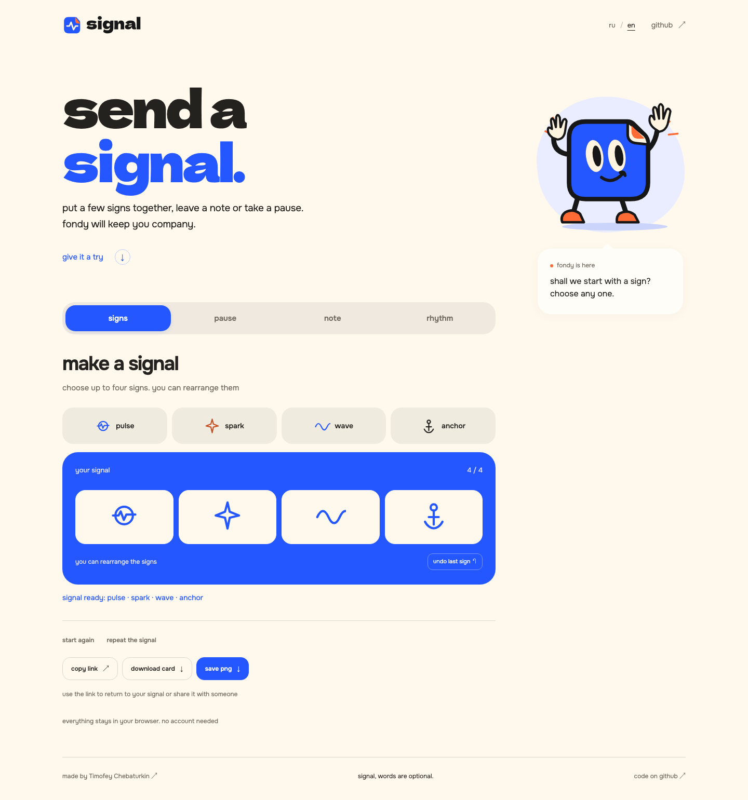
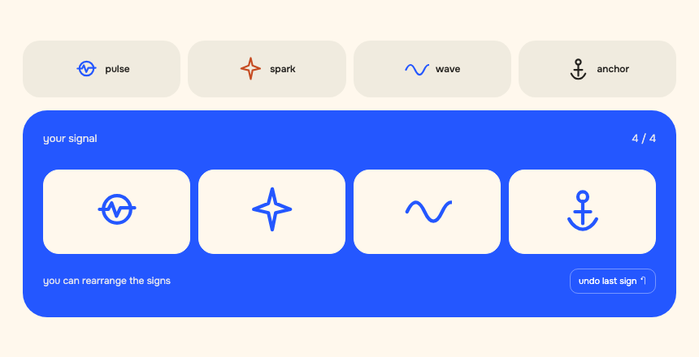
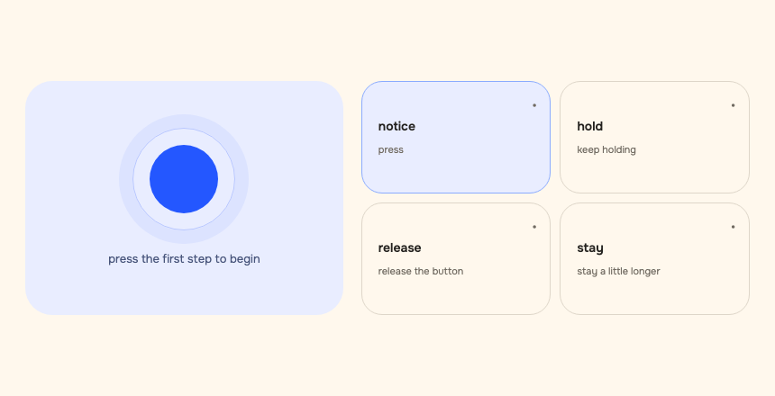
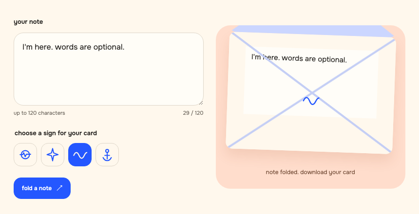
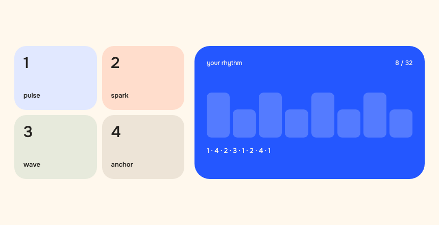
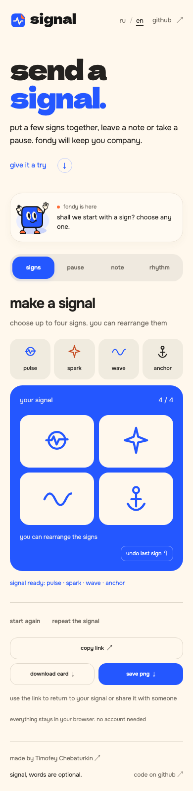

**english** · [русский](README.ru.md)

# signal

a small workshop for signs, notes, pauses and rhythm. make a signal, save a card or share it through a link. fondy stays nearby and responds to what you do.

[open the workshop](https://chebaturkin.github.io/fondy-signal/?lang=en)



everything works in your browser, without an account, server or analytics.

## things to try

<table>
<tr>
<td width="50%" valign="top">

### signs



choose up to four signs and arrange them your way. click, drag and remove the ones you no longer need.

</td>
<td width="50%" valign="top">

### pause



four steps give you a moment to stop. skip any step or begin again whenever you like.

</td>
</tr>
<tr>
<td width="50%" valign="top">

### note



write up to 120 characters, choose a sign and fold the note into an envelope. you can then download it as a card.

</td>
<td width="50%" valign="top">

### rhythm



tap the pads or press keys 1 to 4. a sequence holds up to 32 beats.

</td>
</tr>
</table>

<details>
<summary>on a phone</summary>



scenes and controls adapt to the screen. keyboard controls and reduced motion are supported.

</details>

## save and share

copy the link to return to your result or show it to someone. state is stored in the part of the address after `#`. the note text is part of that link, so anyone who receives it can read it.

download the result as a png or an html card that opens on its own. the html card opens without the workshop. fonts and illustrations ship with the project; the workshop does not need external apis.

## language

the workshop and exported card labels support english and russian. choose `ru / en` beside the github link. a valid `?lang=en` or `?lang=ru` link takes priority, then your saved choice, the first supported browser language and english as the fallback.

switching keeps your signs, rhythm, pause progress and unfinished note. your own words stay as you wrote them.

## run locally

use python 3.11 or newer. checks also need node.js 20 or newer.

```bash
git clone https://github.com/chebaturkin/fondy-signal.git
cd fondy-signal
python3 site/build.py
python3 site/serve.py --port 8799
```

open the [local workshop](http://127.0.0.1:8799/?lang=en). the build creates `site/public`, ready for static hosting. relative asset paths also work from a subdirectory.

## source

| path | contents |
| --- | --- |
| [`site/sections`](site/sections) | scene markup, styling and interactions |
| [`site/lib/workshop-state.js`](site/lib/workshop-state.js) | state validation and link encoding |
| [`site/lib/messages.json`](site/lib/messages.json) | authored russian and english messages |
| [`site/lib/i18n.js`](site/lib/i18n.js) | language selection and explicit text bindings |
| [`site/base.css`](site/base.css) | shared fonts and visual settings |
| [`site/build.py`](site/build.py) | static page and local asset builder |
| [`site/serve.py`](site/serve.py) | local preview server |
| [`brand-kit/assets/mascot`](brand-kit/assets/mascot) | fondy source |
| [`brand-kit/assets/favicons`](brand-kit/assets/favicons) | signal logo and favicon |
| [`brand-kit/fonts`](brand-kit/fonts) | fonts and their licenses |

`site/assets`, `site/index.html` and `site/public` are generated. edit the sources and run `site/build.py` to update them.

more details: [workshop sources](site/README.md) · [visual assets and fonts](brand-kit/README.md). the screenshots above show the english workshop. after starting the local server, run `python3 docs/render_github.py` to refresh both language sets from the working interface.

## checks

```bash
python3 site/build.py
python3 -m pytest -q site/tests
node --test site/tests/*.mjs
python3 site/verify.py
python3 site/verify_languages.py
```

browser checks need python playwright and its chromium, with the local server running. they cover all scenes, keyboard controls, five screen widths, fondy's position while scrolling, reduced motion and exports. language checks also cover unfinished notes, shared state, saved preferences, portable cards and blocked browser storage.

## publishing

changes in `main` are built and published to github pages through the [workflow](.github/workflows/pages.yml). the build uses only project files.

## authorship and licenses

the code, character, illustrations and text belong to Timofey Chebaturkin. a reuse license has not been selected. please ask the author before using these materials in another project.

dela gothic one and onest use the sil open font license. copies are included in [`brand-kit/fonts`](brand-kit/fonts).

[Timofey Chebaturkin](https://chebaturkin.com) · signal
