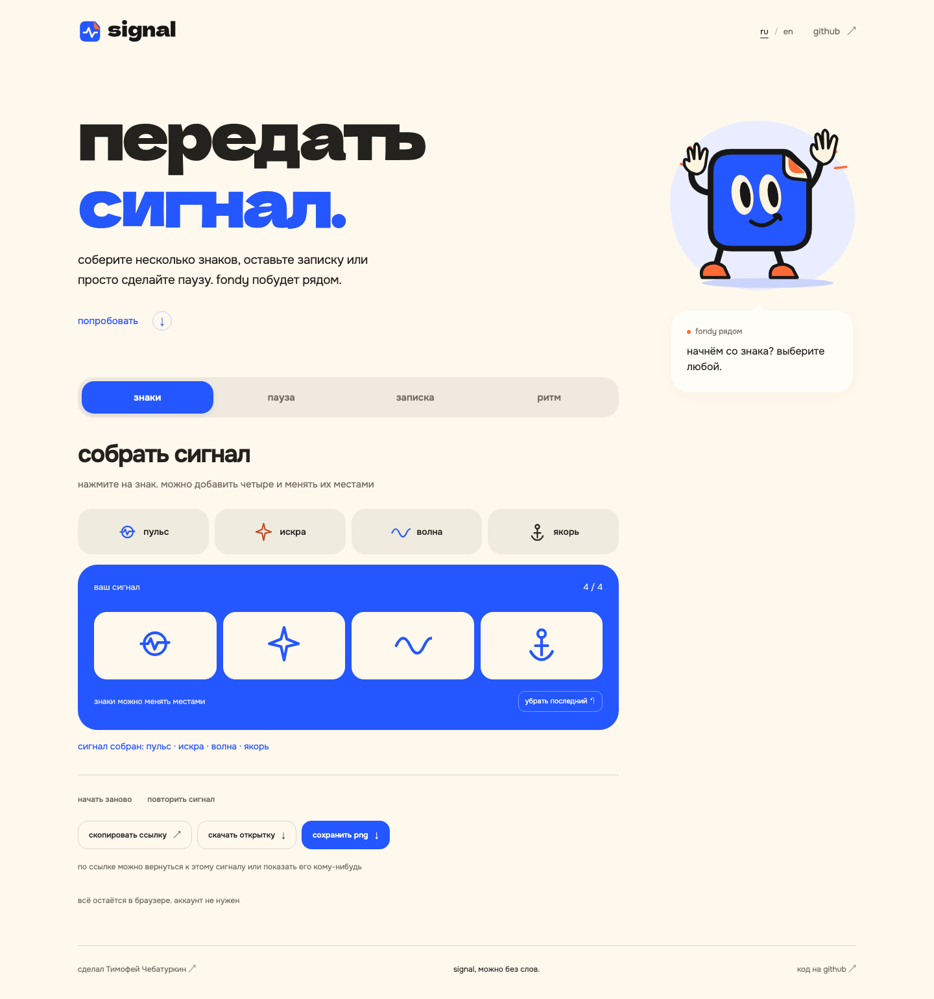
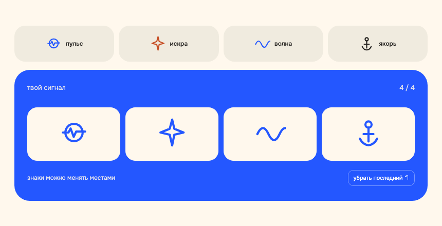
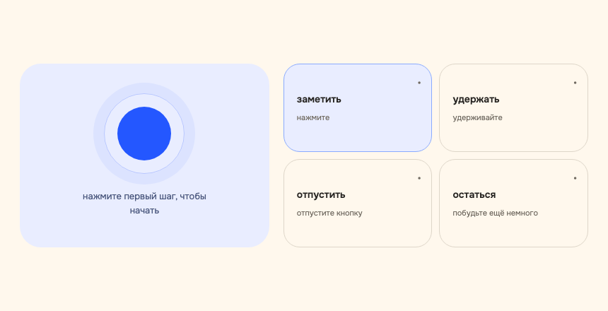
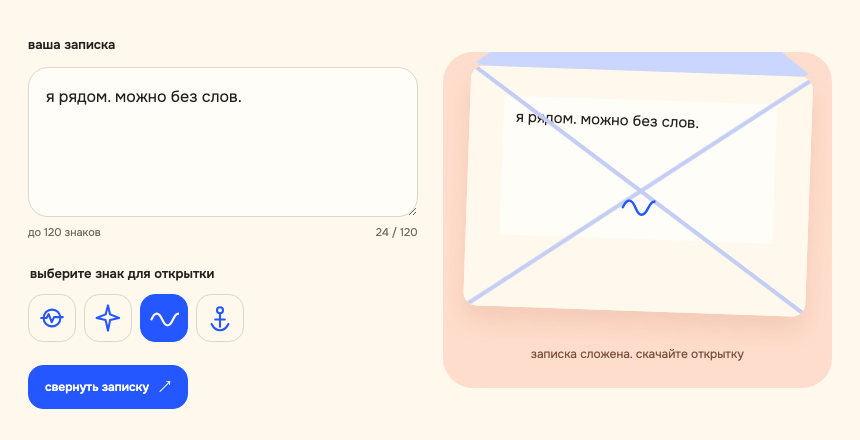
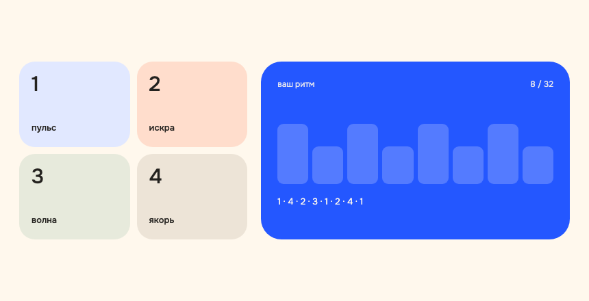
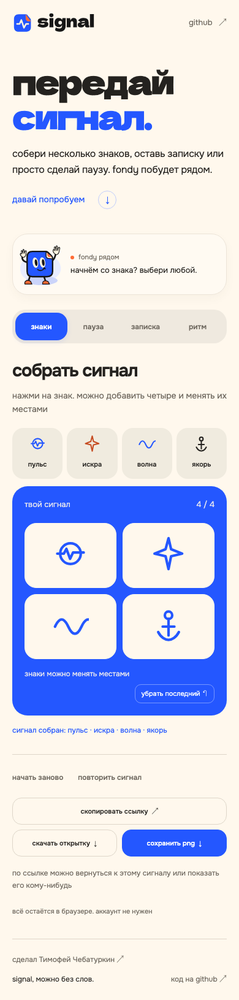

[english](README.md) · **русский**

# signal

небольшая мастерская со знаками, записками, паузой и ритмом. соберите свой сигнал, сохраните открытку или передайте её по ссылке. fondy побудет рядом и отреагирует на ваши действия.

[открыть мастерскую](https://chebaturkin.github.io/fondy-signal/?lang=ru)



всё работает в браузере. без аккаунта, сервера и аналитики.

## чем можно заняться

<table>
<tr>
<td width="50%" valign="top">

### знаки



выберите до четырёх знаков и расставьте их по-своему. можно нажимать, перетаскивать и убирать лишнее.

</td>
<td width="50%" valign="top">

### пауза



четыре шага помогают ненадолго остановиться. любой из них можно пропустить или начать паузу заново.

</td>
</tr>
<tr>
<td width="50%" valign="top">

### записка



напишите до 120 знаков, выберите символ и сверните записку в конверт. потом её можно скачать как открытку.

</td>
<td width="50%" valign="top">

### ритм



нажимайте кнопки или клавиши от 1 до 4. в последовательности помещается до 32 ударов.

</td>
</tr>
</table>

<details>
<summary>а так она выглядит на телефоне</summary>



сцены и кнопки подстраиваются под экран. управление с клавиатуры и режим уменьшенного движения тоже есть.

</details>

## сохранить и передать

скопируйте ссылку, чтобы вернуться к результату или показать его кому-нибудь. состояние хранится в части адреса после `#`. текст записки тоже входит в ссылку: получатель сможет его прочитать.

результат можно скачать как png или как отдельную html-открытку. открытка открывается без подключения к мастерской.

шрифты и иллюстрации хранятся рядом с кодом. для работы не нужны внешние api.

## язык

мастерская и подписи открыток доступны на русском и английском. выбирайте `ru / en` рядом со ссылкой на github. сначала учитывается корректный `?lang=ru` или `?lang=en` в ссылке, затем сохранённый выбор, первый поддерживаемый язык браузера и английский как запасной.

переключение сохраняет знаки, ритм, пройденные шаги паузы и незавершённую записку. ваши слова остаются как написаны.

## запустить локально

нужен python 3.11+. для проверок понадобится node.js 20+.

```bash
git clone https://github.com/chebaturkin/fondy-signal.git
cd fondy-signal
python3 site/build.py
python3 site/serve.py --port 8799
```

откройте [мастерскую в браузере](http://127.0.0.1:8799/?lang=ru). сборка создаёт статическую папку `site/public`, которую можно разместить на хостинге. пути к ресурсам относительные, поэтому страница работает и из подпапки.

## как устроен проект

| путь | что здесь |
| --- | --- |
| [`site/sections`](site/sections) | разметка, оформление и действия сцен |
| [`site/lib/workshop-state.js`](site/lib/workshop-state.js) | проверка состояния и его кодирование в адрес |
| [`site/lib/messages.json`](site/lib/messages.json) | русские и английские тексты |
| [`site/lib/i18n.js`](site/lib/i18n.js) | выбор языка и привязка текстов к интерфейсу |
| [`site/base.css`](site/base.css) | общие шрифты и визуальные настройки |
| [`site/build.py`](site/build.py) | сборка страницы и локальных ресурсов |
| [`site/serve.py`](site/serve.py) | сервер для локального просмотра |
| [`brand-kit/assets/mascot`](brand-kit/assets/mascot) | исходник fondy |
| [`brand-kit/assets/favicons`](brand-kit/assets/favicons) | логотип signal и фавикон |
| [`brand-kit/fonts`](brand-kit/fonts) | шрифты и их лицензии |

`site/assets`, `site/index.html` и `site/public` создаются сборкой. меняйте исходники и запускайте `site/build.py`, чтобы обновить страницу.

подробнее: [исходники мастерской](site/README.md) · [визуальные материалы и шрифты](brand-kit/README.md). на снимках выше русская версия интерфейса. команда `python3 docs/render_github.py` обновляет оба языковых набора из работающей мастерской после запуска локального сервера.

## проверить изменения

```bash
python3 site/build.py
python3 -m pytest -q site/tests
node --test site/tests/*.mjs
```

для браузерных проверок нужен python-пакет playwright и его chromium. с работающим локальным сервером:

```bash
python3 site/verify.py
python3 site/verify_languages.py
```

проверки проходят сцены, клавиатуру, пять размеров экрана, положение fondy при прокрутке, reduced motion и экспорт. языковая проверка также сохраняет незавершённую записку и состояние ссылки, проверяет настройки языка и создание открытки при смене языка.

## публикация

изменения в `main` собираются и публикуются на github pages через [workflow](.github/workflows/pages.yml). сборка использует только файлы проекта.

## авторство и лицензии

код, персонаж, иллюстрации и тексты signal принадлежат Тимофею Чебатуркину. отдельная лицензия на переиспользование пока не выбрана. для использования материалов в другом проекте нужно разрешение автора.

dela gothic one и onest распространяются по sil open font license. копии лицензий находятся в [`brand-kit/fonts`](brand-kit/fonts).

[Тимофей Чебатуркин](https://chebaturkin.com) · signal
